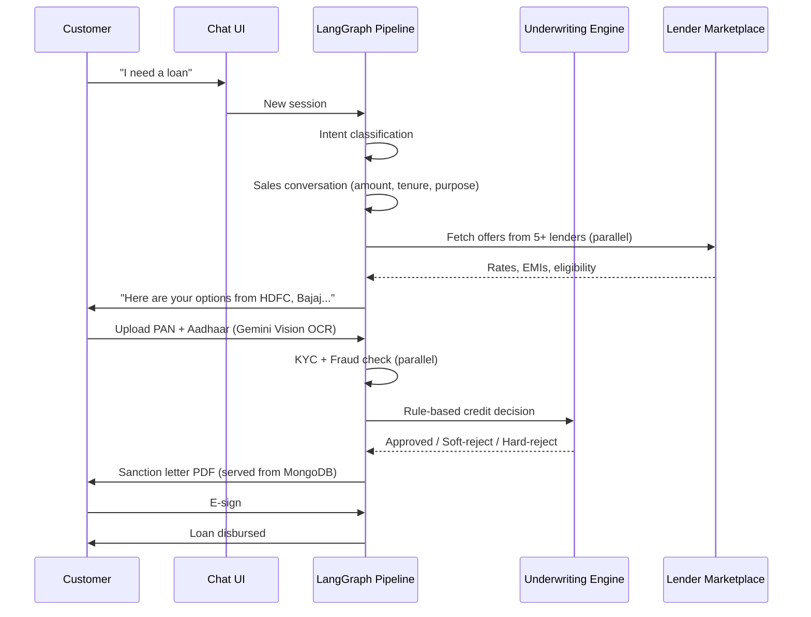
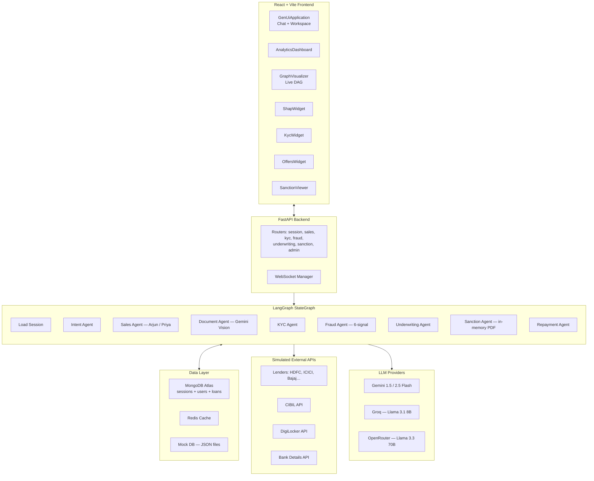
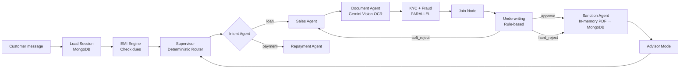
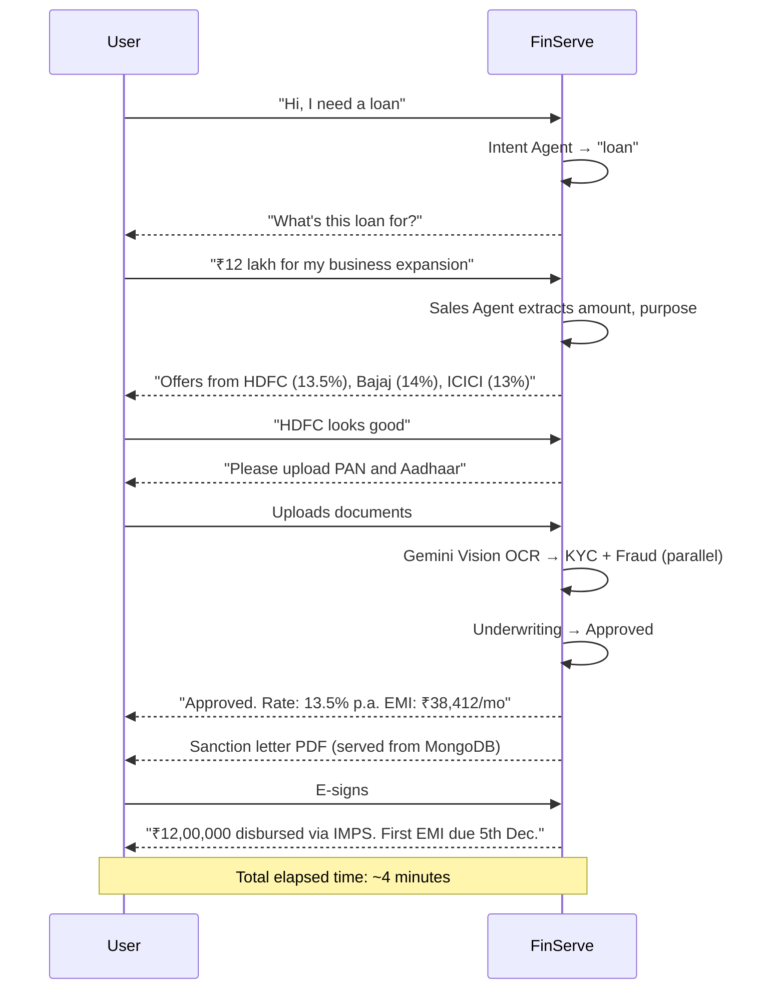
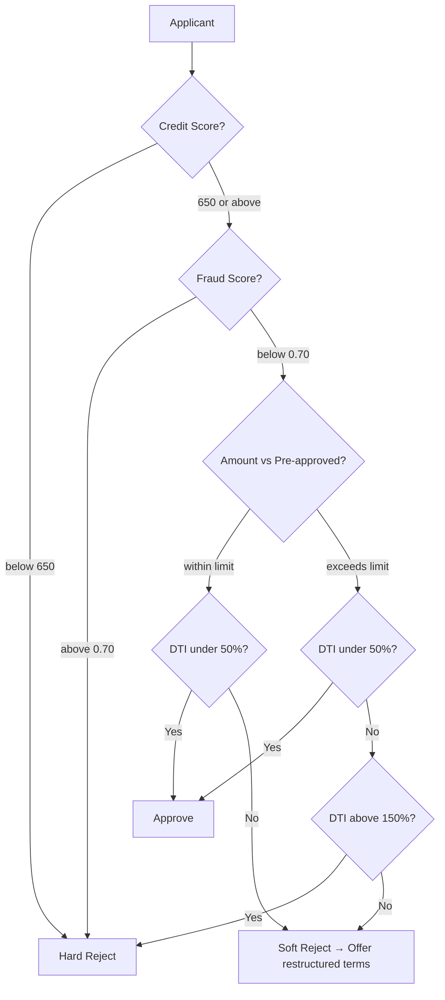

<p align="center">
  
  
  
  
  
  
  
</p>

<h1 align="center">FinServe NBFC</h1>
<p align="center"><strong>AI-native loan origination platform — multi-agent pipeline, real-time credit decisioning, and a multi-lender marketplace.</strong></p>

<br>

> **NBFC** = Non-Banking Financial Company. This platform handles the complete loan lifecycle — from a customer saying *"I need ₹5 lakh"* to funds being disbursed — using a deterministic LangGraph StateGraph, Gemini Vision document forensics, rule-based underwriting, and a conversational React workspace.

---

## The Problem

Applying for a loan at an Indian NBFC is fragmented and high-friction:

- **Manual underwriting** takes 3–7 days with constant back-and-forth
- **Paper documents** get lost, re-uploaded, or flagged incorrectly
- **No transparency** — applicants wait with no visibility into where they stand
- **Multiple lenders** means filling the same form five times
- **Fraud checks** happen late in the pipeline, wasting underwriting effort

This project collapses that 7-day process into a **single conversational session** with real-time feedback, automated decisioning, and a legally-formatted sanction letter — all in roughly four minutes.

---

## How It Works



---

## Features

| Layer | Capability | Implementation |
|-------|-----------|----------------|
| **Conversational Sales** | Dual AI personas: *Arjun* (loan specialist) and *Priya* (financial advisor) | LangChain + LLM with structured JSON extraction |
| **Intent Detection** | Classifies user intent before routing: loan / advice / KYC / payment | LLM + regex fallback; zero LLM overhead for confirmations |
| **Document Forensics** | Real OCR + tamper detection on PAN, Aadhaar, salary slips, bank statements | Gemini 2.5 Flash Vision multimodal |
| **KYC Verification** | Cross-checks document name against CRM, validates document tier per loan amount | Rule-based token overlap |
| **Fraud Screening** | 6-signal risk scoring: name mismatch, income inflation, document tampering, velocity | Fully deterministic — no LLM overhead |
| **Underwriting** | DTI/FOIR, credit score tiers, employer whitelist, LTV checks, force-reject overrides | Pure rules — transparent and auditable |
| **Multi-Lender Marketplace** | Parallel offer fetch from 5+ lenders; best offer pre-selected, all options shown | `ThreadPoolExecutor` + eligibility scoring |
| **Soft-Reject Negotiation** | Restructures terms when request exceeds computed capacity | Alternative amount/EMI calculation |
| **Sanction Letter PDF** | Legally-formatted PDF generated in-memory, stored in MongoDB, streamed on download | ReportLab + base64 in MongoDB (no disk/S3) |
| **SHAP Explainability** | Feature-level contribution waterfall for every credit decision | Custom SHAP engine — shows each variable's rate and limit impact |
| **EMI Engine** | Tracks payment history; dynamically adjusts credit score (up for on-time, down for overdue) | Motor persistence + in-memory simulation |
| **Reducing-Balance EMI** | `P·r·(1+r)^n / ((1+r)^n − 1)` used consistently across all UI surfaces | Applied in OffersWidget, SanctionViewer, AnalyticsDashboard |
| **Session Continuity** | Chat history persisted in Zustand store + MongoDB; restored on login via `/session/by-phone` | Zustand persist middleware + Motor upsert |
| **LangGraph Tracing** | Per-node timing spans stored as `trace_events`; last 5 sent in every chat response | Custom `Span` dataclass + LangSmith integration |
| **XSS-Safe Markdown** | Bold/italic rendering via JSX instead of `dangerouslySetInnerHTML` | `renderBoldSegments()` splits on `**...**` |
| **CRM Sync** | Customer data synced back to Users collection on every session save | Motor upsert in `session_manager.py` |
| **Admin Dashboard** | Portfolio analytics with real loan history from MongoDB | FastAPI aggregation endpoint + React |

---

## Architecture



### State Flow



---

## Repository Structure

```
NBFC/
├── agents/                      # LangGraph agent nodes
│   ├── master_graph.py          # StateGraph definition — nodes, edges, parallel fan-out
│   ├── master_router.py         # Deterministic rule-based router (zero LLM calls)
│   ├── master_state.py          # MasterState TypedDict — full pipeline schema
│   ├── session_manager.py       # MongoDB persistence + CRM sync + trace_events
│   ├── tracer.py                # Span dataclass — per-node latency tracking
│   ├── intent_agent.py          # LLM classifies: loan / advice / kyc / payment
│   ├── sales_agent.py           # Arjun (sales) / Priya (advisor) dual persona
│   ├── document_agent.py        # Gemini Vision OCR + forensic extraction
│   ├── document_query_agent.py  # "What documents do I need?" (async LLM)
│   ├── kyc_agent.py             # CRM name cross-check + document tier validation
│   ├── fraud_agent.py           # 6-signal deterministic fraud scoring
│   ├── underwriting.py          # DTI, FOIR, credit score, LTV, employer rules
│   ├── sanction_agent.py        # In-memory PDF → base64 → MongoDB
│   ├── emi_engine.py            # Payment simulation + dynamic credit scoring
│   └── repayment_agent.py       # EMI payment guidance
│
├── api/                         # FastAPI backend
│   ├── main.py                  # App entry, CORS, error handlers, WebSocket
│   ├── config.py                # Pydantic Settings (env-based)
│   ├── routers/                 # 12 domain routers
│   │   ├── session.py           # Session CRUD + /by-phone + /history
│   │   ├── sales.py             # /chat endpoint
│   │   ├── documents.py         # /upload endpoint (real file → Gemini)
│   │   ├── sanction.py          # /download-letter (MongoDB → bytes stream)
│   │   ├── underwriting.py      # SHAP explainability endpoint
│   │   └── admin.py             # Portfolio analytics
│   ├── schemas/                 # Pydantic request/response models
│   └── core/
│       ├── redis_cache.py       # LLM response cache + session TTL
│       ├── email_service.py     # SMTP sanction notifications
│       └── state_manager.py     # get_session / update_session / advance_phase
│
├── frontend/                    # React 19 + Vite + Tailwind + Framer Motion
│   └── src/
│       ├── store/
│       │   └── useLoanStore.ts  # Zustand with persist — chatHistory, appState, loanDetails
│       ├── lib/
│       │   └── api.ts           # Typed REST client
│       └── components/
│           └── workspace/
│               ├── pages/
│               │   ├── GenUiApplication.tsx   # Main chat + orchestration
│               │   └── AnalyticsDashboard.tsx # Real-data portfolio dashboard
│               └── widgets/
│                   ├── GraphVisualizer.tsx    # Live LangGraph DAG
│                   ├── ShapWidget.tsx         # SHAP waterfall (real + fallback)
│                   ├── OffersWidget.tsx       # Multi-lender offer cards
│                   ├── SanctionViewer.tsx     # PDF preview + IMPS disbursal
│                   └── KycWidget.tsx          # Real file upload → Gemini OCR
│
├── db/
│   ├── database.py              # Motor client + collection init + mock fallback
│   └── schemas.py               # LoanComparison, LenderOffer
│
├── mock_apis/
│   ├── lenders.json             # 7 lender definitions — rates, limits, FOIR caps
│   ├── customers.json           # Pre-seeded customer profiles
│   ├── lender_apis.py           # Parallel offer fetch + eligibility scoring
│   ├── cibil_api.py             # Credit score simulation
│   ├── digilocker_api.py        # Document verification mock
│   └── bank_details_api.py      # Account validation mock
│
├── utils/
│   ├── financial_rules.py       # EMI (reducing-balance), FOIR, pricing, fraud
│   ├── eligibility_checker.py   # Product-level eligibility checks
│   └── loan_ranker.py           # Multi-lender ranking engine
│
├── config.py                    # LLM fallback chain: Groq → Gemini → OpenRouter
├── requirements.txt
└── .env.example
```

---

## Tech Stack

| Layer | Technology | Rationale |
|-------|-----------|-----------|
| **Agent Framework** | [LangGraph](https://github.com/langchain-ai/langgraph) StateGraph | Deterministic routing; no LLM wasted on supervisor decisions |
| **LLM Providers** | Groq (Llama 3.1 8B) → Gemini (1.5 Flash) → OpenRouter (Llama 3.3 70B) | Automatic fallback chain — starts with fastest and cheapest |
| **Vision / OCR** | Gemini 2.5 Flash multimodal | Real document forensics + tamper detection |
| **Backend** | FastAPI + Uvicorn | Async-native, auto-docs at `/docs`, WebSocket support |
| **Frontend** | React 19 + Vite + Tailwind + Framer Motion | Fast development loop; staggered animations for agent indicators |
| **State Management** | Zustand with `persist` middleware | Chat history survives tab navigation and login/logout |
| **Database** | MongoDB Atlas (Motor async) | Document model fits loan state; Motor for async upserts |
| **PDF** | ReportLab → `io.BytesIO` → base64 | In-memory generation; stored in MongoDB, no disk or S3 needed |
| **Cache** | Redis / Memurai | LLM response caching, session TTL |
| **Tracing** | LangSmith + custom `Span` dataclass | Per-node latency spans stored in `trace_events`; last 5 returned per chat turn |
| **EMI Formula** | Reducing-balance: `P·r·(1+r)^n / ((1+r)^n − 1)` | Applied consistently across all three UI components |

### Why a Deterministic Router?

`master_router.py` uses pure Python rule-based logic — no LLM — to decide which agent runs next:

- **Cost**: Every LLM call costs money and adds latency. The router costs $0.
- **Predictability**: The pipeline is fully deterministic. Every routing decision is in `action_log` with a human-readable reason.
- **Debuggability**: When a test fails, the route decision is visible — no prompt ambiguity to chase.
- **Parallelism**: KYC and Fraud agents execute simultaneously because the router knows they're independent.

```python
# Simplified routing example
if intent == "loan" and not loan_confirmed:
    return "sales_agent", "Gathering loan requirements"
if intent == "loan" and documents_uploaded and kyc == "pending":
    return "verification_agent", "Proceeding to KYC"
if kyc == "failed":
    return "document_agent", "KYC failed — requesting corrected documents"
```

---

## Getting Started

### Prerequisites

- Python 3.10+
- Node.js 18+
- MongoDB Atlas account (or local MongoDB)
- At least one LLM API key (Groq is free and fastest for development)

### Installation

```bash
# 1. Clone
git clone https://github.com/SarangRao20/NBFC.git
cd NBFC

# 2. Backend
python -m venv venv && source venv/bin/activate
pip install -r requirements.txt

# 3. Environment
cp .env.example .env
# Edit .env — at minimum set GROQ_API_KEY or GEMINI_API_KEY and MONGO_URI

# 4. Frontend
cd frontend && npm install && cd ..
```

### Running

```bash
# Terminal 1 — Backend
python main.py
# → http://localhost:8000
# → http://localhost:8000/docs  (Swagger / OpenAPI)

# Terminal 2 — Frontend
cd frontend && npm run dev
# → http://localhost:5173
```

**Without any LLM key** — the sales agent returns static responses, but the full pipeline (intent → documents → KYC → fraud → underwriting → sanction letter) still executes for integration testing.

**Without MongoDB** — set `MONGO_URI=mock` in `.env`. Everything runs on local JSON files in `mock_apis/`.

---

## Configuration

| Variable | Default | Notes |
|----------|---------|-------|
| `GROQ_API_KEY` | — | Recommended for development (free tier available) |
| `GEMINI_API_KEY` | — | Required for document Vision OCR |
| `MONGO_URI` | `mock` | Set to your MongoDB Atlas connection string |
| `JWT_SECRET` | — | Generate with `python -c "import secrets; print(secrets.token_hex(48))"` |
| `DISABLE_OTP` | `false` | Set `true` in development (accepts `123456`) |
| `APP_ENV` | `development` | Set `production` for deployment |
| `MIN_CREDIT_SCORE` | `700` | Underwriting hard floor |
| `MAX_DTI_RATIO` | `0.50` | 50% debt-to-income ceiling |
| `LANGCHAIN_API_KEY` | — | Optional: LangSmith distributed tracing |

Full list in `.env.example`.

---

## API Reference

### Key Endpoints

| Method | Path | Purpose |
|--------|------|---------|
| `POST` | `/session/start` | Create a new loan session |
| `POST` | `/session/{id}/chat` | Send message — triggers the full LangGraph pipeline |
| `GET` | `/session/{id}/history` | Retrieve persisted chat history |
| `GET` | `/session/by-phone/{phone}` | Look up all sessions for a phone number |
| `POST` | `/documents/upload/{id}` | Upload document — routes to Gemini Vision OCR |
| `POST` | `/session/{id}/select-lender` | Confirm lender selection + run pre-underwriting check |
| `POST` | `/session/{id}/shap-explain` | Compute SHAP feature waterfall for credit decision |
| `GET` | `/session/{id}/download-letter` | Stream sanction/rejection PDF from MongoDB |
| `POST` | `/session/{id}/esign-accept` | Accept e-sign and trigger disbursement |
| `POST` | `/auth/login` | Authenticate and restore most-recent session |
| `GET` | `/admin/analytics` | Portfolio metrics |

Full OpenAPI spec at `http://localhost:8000/docs`.

### WebSocket Events

```
ws://localhost:8000/ws/{session_id}

Server → Client:
  { "type": "AGENT_THINKING", "agent": "Arjun", "thinking": true }
  { "type": "NOTIFICATION",   "priority": "high", "message": "..." }
  { "type": "AGENT_MESSAGE",  "agent": "...",     "content": "..." }
```

---

## Example Workflow



---

## Underwriting Rules

The underwriting engine uses explicit, documented thresholds — no black-box decisions:



Additional rules applied:
- Employer whitelist (Google, Microsoft, TCS, Infosys, etc.) → automatic low-risk flag
- Secured loans (home/vehicle) → LTV check (must be below 85%)
- Existing EMI burden tracked and updated after each disbursement
- Developer shortcut: set `loan_purpose = "force reject"` or `principal = 99999` to test rejection flows

---

## SHAP Explainability

Every credit decision comes with a feature-level waterfall showing exactly why the rate and limit were computed:

| Risk Variable | Rate Impact | Limit Added |
|---------------|-------------|-------------|
| Base Benchmark | 12.50% | ₹3,00,000 |
| CIBIL Bureau Score (800+) | −2.00% | +₹5,00,000 |
| Monthly Net Income (₹1.5L+) | −0.50% | +₹4,50,000 |
| FOIR / Existing Debt (< 25%) | −0.25% | +₹2,00,000 |
| Location Tier (Mumbai Metro) | −0.25% | +₹1,00,000 |
| **Final Approved Rate** | **9.50%** | **₹15,50,000** |

The SHAP engine runs entirely in Python (`api/services/shap_service.py`) — no ML library required. Frontend falls back to a client-side computation from the user's live profile when the session API is unavailable.

---

## Multi-Lender Marketplace

Offers are fetched in parallel the moment a customer confirms loan terms:

```python
with ThreadPoolExecutor(max_workers=len(lender_ids)) as executor:
    futures = {executor.submit(fetch_lender_offer, ...): lid for lid in lender_ids}
```

Each lender in `mock_apis/lenders.json` defines:
- Min/max loan amount and tenure
- Base rate + credit-score-based adjustment curve
- Maximum FOIR (EMI/salary ratio)
- Risk profile and typical approval probability
- Settlement timeline (1–3 days)

The best offer by rate is pre-selected; the user sees all options and can choose.

---

## Performance Notes

| Metric | Value |
|--------|-------|
| End-to-end loan cycle | ~4 minutes (vs 3–7 days manually) |
| LLM calls per turn | 1 (supervisor router costs $0) |
| Underwriting latency | < 50ms (pure Python, no I/O) |
| KYC + Fraud | Parallel execution — adds 0ms vs sequential |
| PDF generation | In-memory, no disk write, < 200ms |
| Session restore | Via `/session/by-phone` on login — no fresh-start friction |

---

## Known Limitations

- **Mock external APIs** — CIBIL, DigiLocker, bank verification, and lender offer APIs are simulated with JSON files. Replacing them requires implementing the real API clients in `mock_apis/`.
- **Single-process pipeline** — agents run in-process within FastAPI. For production throughput, decouple into worker queues (Celery + Redis Queue).
- **EMI simulation** — the payment engine simulates disbursement and credit score updates; ACH/NEFT mandate automation is not implemented.
- **No WhatsApp / Telegram channel** — currently web-only; Twilio SMS OTP is stubbed.

---

## Roadmap

- [ ] Replace mock APIs with real integrations (CIBIL, DigiLocker, GST, UPI, NPCI)
- [ ] Decouple agents into async worker queue (Celery / Redis Queue)
- [ ] Add LLM-as-Judge evaluation harness for sales agent response quality
- [ ] WhatsApp / Telegram channel via Twilio
- [ ] A/B testing framework for underwriting rules
- [ ] Automated repayment pipeline (ACH/NEFT mandate)
- [ ] Co-lending and syndication support
- [ ] Multi-language support (Hindi, Tamil, Kannada)

---

## Design Principles

- **No LLM in routing decisions** — the supervisor router is pure Python. Deterministic, auditable, and free.
- **Every agent writes to `action_log`** — the full decision trail is visible in the UI with human-readable reasoning.
- **Sessions are always resumable** — any point in the pipeline can be interrupted and restored from MongoDB.
- **Reducing-balance EMI everywhere** — `P·r·(1+r)^n / ((1+r)^n − 1)` applied consistently, not simple interest approximations.
- **No disk for PDFs** — sanction letters are generated in-memory and stored as base64 in MongoDB. Zero dependency on ephemeral filesystem.
- **Mock before real** — every external integration has a mock counterpart for offline development and CI.

---

## License

MIT. See `LICENSE` for details.
